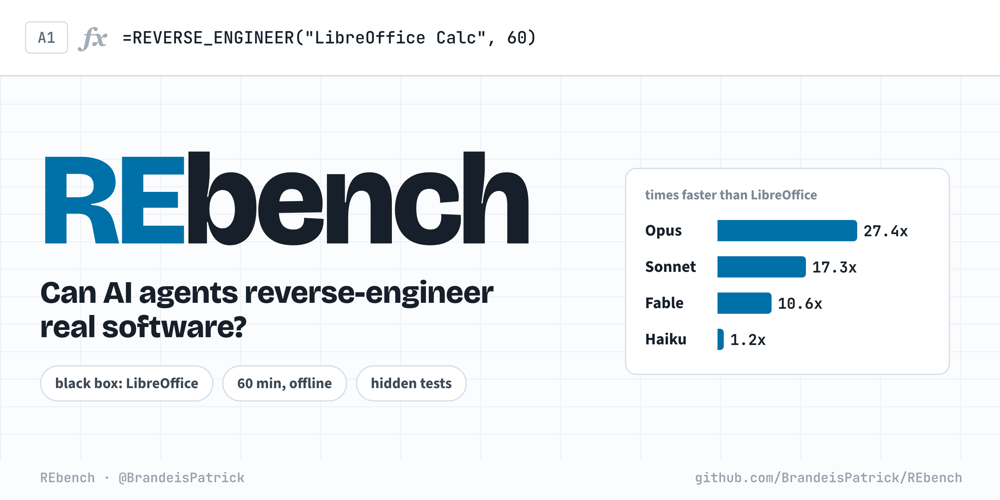
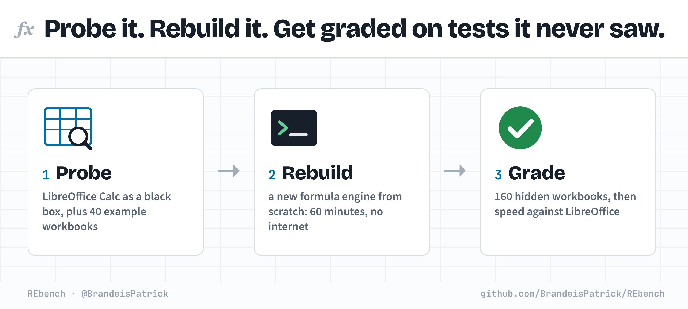
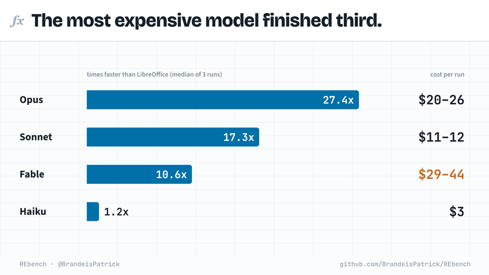
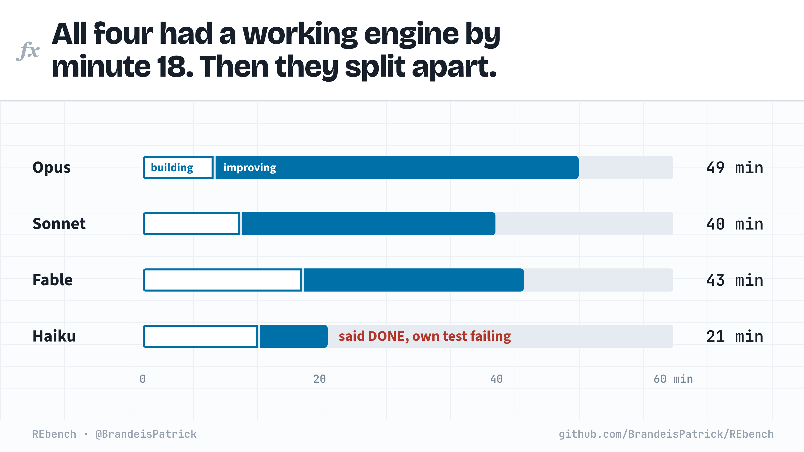
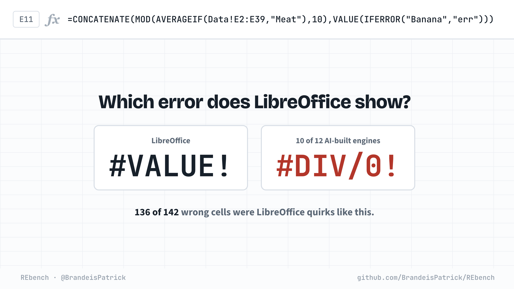
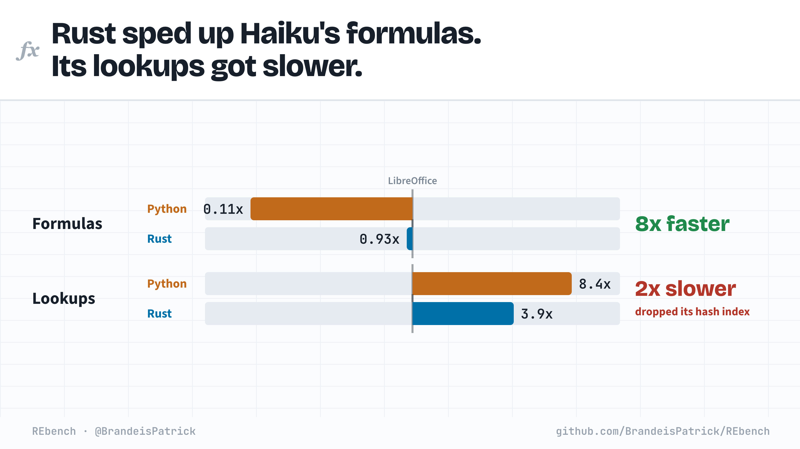
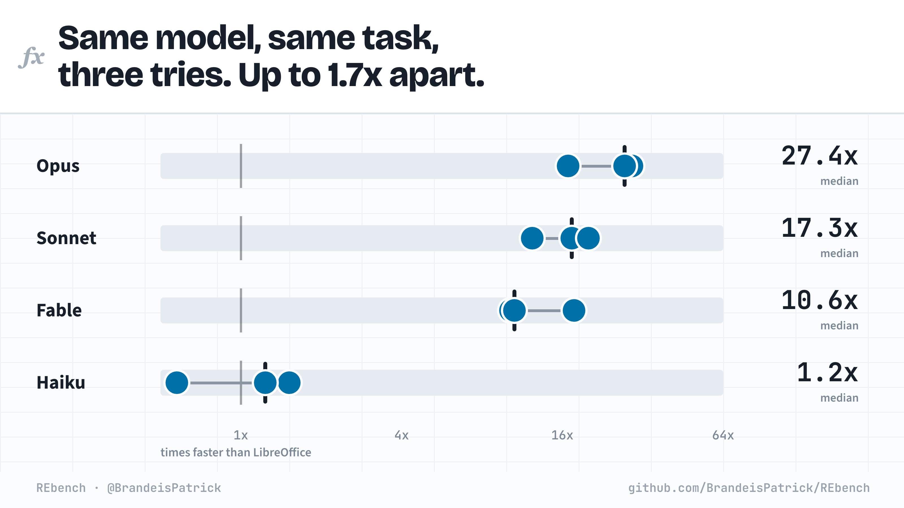

<p align="center">
  
</p>

<p align="center">
  
  
  
  
  
  <a href="LICENSE"></a>
</p>

**Can an AI agent reverse-engineer real software from its behavior alone?** REbench gives it a running application,
60 minutes and no internet. The agent rebuilds the application from scratch, and a separate grader checks the rebuild
on inputs it never saw: exact results first, then speed. The first task is **LibreOffice Calc's formula engine**.



## Results



| Model | Median speed vs LibreOffice | Passed the hidden tests |
|---|---|---|
| Opus 5.5 | **27.4x** | 3 of 3 |
| Sonnet 5.5 | 17.3x | 3 of 3 |
| Fable 5.1 | 10.6x | 2 of 3 |
| Haiku 5.5 | 1.2x | 1 of 3 |

Three attempts per model, graded on 160 hidden workbooks generated after every run had finished.
[Every attempt](runs/RESULTS.md) · [full analysis](runs/results.html) (download and open in a browser)

## What the agents did

**A working engine took under 20 minutes.** Opus, Sonnet and Fable kept improving it; Haiku stopped.



**What's left is LibreOffice's quirks.** 136 of 142 wrong cells come from five conventions, and most engines miss the same ones.



**Data structures beat the language.** Haiku's Rust engine dropped the hash index its Python engine had.



**One run can't rank models.** Attempts by the same model differ by up to 1.7x.



## Run it

Needs Docker (4 CPUs, 6 GB), Python 3 and a logged-in [Claude Code](https://docs.claude.com/en/docs/claude-code) CLI.

```bash
python3 -m venv .venv && .venv/bin/pip install mcp
for img in toolchain agent-calc grader oracle; do docker build -f docker/$img.Dockerfile -t rb-$img .; done
.venv/bin/python harness/run.py --model claude-opus-5-5 --condition full --minutes 60 --run-id my-run --defer-grade
harness/make_evalset.sh my-set
.venv/bin/python harness/finish_run.py my-run --grade-only --evalset my-set
```

Add `--lang rust` to `run.py` for the Rust-only condition. `harness/report.py` collects every graded run into
`runs/RESULTS.md`.

<details>
<summary><b>How a run works</b></summary>

1. `harness/run.py` starts the offline agent sandbox and runs Claude Code headless (`claude -p`) with no built-in
   tools. The agent works only through the sandbox tools in `harness/sandbox_mcp.py`: shell, file read, write and
   edit, and screenshot, click, type, key, scroll and drag for the LibreOffice window. Tool calls go to `tools.jsonl`
   and the transcript to `claude_stream.jsonl`. An agent that stops early is told how many minutes are left.
2. After every run in the round has finished, `harness/make_evalset.sh` generates a fresh evaluation set from random
   seeds: 160 workbooks, four performance workloads, and LibreOffice's answers and timings.
3. `harness/finish_run.py` builds and scores the submission in a clean grader container: no network, no
   LibreOffice, 4 pinned cores, 6 GB, an unprivileged user. Prebuilt binaries and spreadsheet libraries are rejected.

The pilot round used Claude Code subagents restricted by instruction and audited afterwards; their tool logs are
included, their transcripts are not.
</details>

<details>
<summary><b>Scoring</b></summary>

- **Correctness gate:** at least 99.9% of hidden formula cells and 95% of hidden workbooks fully correct.
- **Speed:** the geometric mean of the speedup over LibreOffice on a 60k-formula dependency chain, 10k mixed
  formulas, 5k exact lookups and 1k SUMIFS/COUNTIFS/AVERAGEIFS. A workload under 99.9% correct counts as 1/8.
  LibreOffice is timed warm (load plus recalculation); the rebuild is timed as its whole process.
- **Score:** 0.5 + log2(speed)/6, clipped to 0–1, when the gate passes. Parity scores 0.5 and 8x scores 1.0.
</details>

<details>
<summary><b>Repository layout</b></summary>

| Path | Contents |
|---|---|
| `tasks/calc/agent/` | What the agent sees: [`CONTRACT.md`](tasks/calc/agent/CONTRACT.md), its tools and the 40 public examples |
| `tasks/calc/oracle/` | The workbook generator and the scripts that record LibreOffice's answers and timings |
| `docker/` | Images: toolchain, agent sandbox, grader, oracle |
| `grader/` | Builds and scores a submission |
| `harness/` | Runs attempts, makes evaluation sets, grades, reports, draws these images |
| `data/calc/` | Public examples and every evaluation set used, with seeds and LibreOffice's answers |
| `runs/` | One folder per attempt: prompt, source, tool log, transcript, and every wrong cell |
</details>

## Related

[ProgramBench](https://arxiv.org/abs/2605.03546) asks agents to rebuild programs from an executable, and
[MirrorCode](https://arxiv.org/abs/2606.30182) rebuilds programs from behavior alone. REbench gives the agent the
running application itself, generates its hidden tests after the runs, and also scores speed against the original.

Next tasks are in [DESIGN.md](DESIGN.md): `raw` (darktable), `layers` (Krita and GIMP) and `docx` (LibreOffice Writer).

## License

[MIT](LICENSE)
